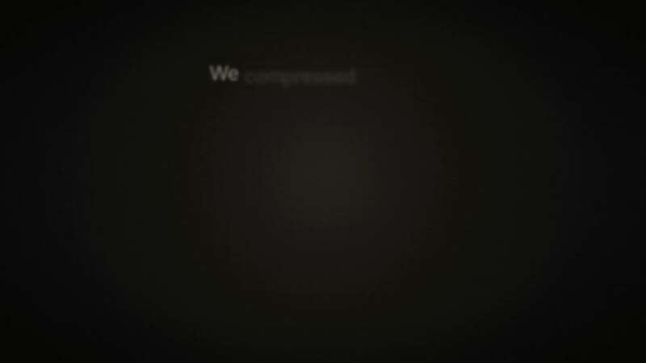
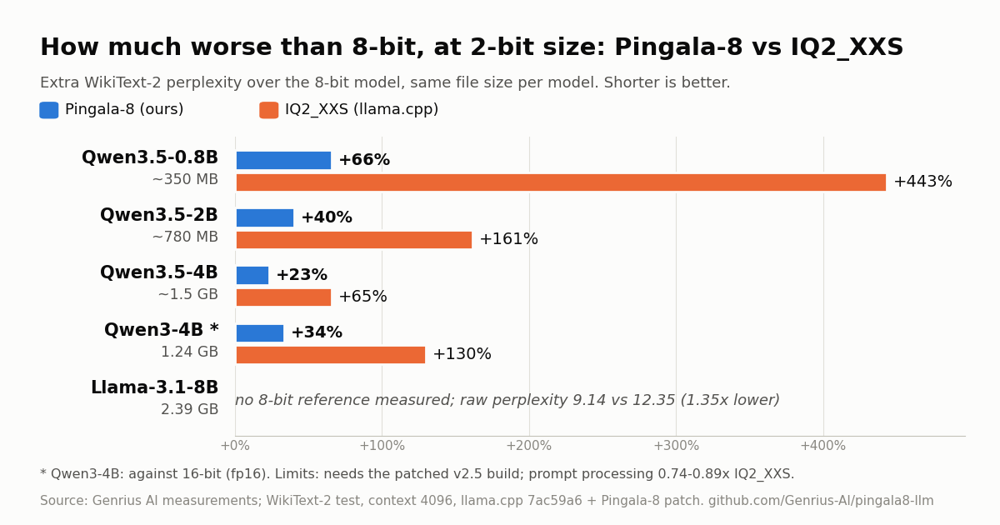

# Pingala-8: small-state coset trellis coding at IQ2_XXS size

<p align="center">
  <a href="https://github.com/Genrius-AI/pingala8-llm/releases/download/v2.4-oneclick/Pingala8-demo-1080p.mp4"></a>
  <br><sub>Click for the 31-second demo video (MP4, 4.3 MB). Text and timing from a real run; chat window recreated.</sub>
</p>

**Will it fit your GPU?** Try the [VRAM calculator](https://huggingface.co/spaces/Genrius-AI/llm-vram-calculator) | [](https://huggingface.co/Genrius-AI/Qwen3-4B-Pingala8-2bit) [](https://huggingface.co/Genrius-AI/Llama-3.1-8B-Pingala8-2bit) [](https://github.com/Genrius-AI/pingala8-llm)

If Pingala-8 saves you VRAM, a star helps others find it.

**We make LLMs 85% smaller, with no retraining.** Pingala-8 is a 2-bit format for llama.cpp: Qwen3-4B goes from 8.05 GB to 1.24 GB (6.5x smaller), Llama-3.1-8B from 16.08 GB to 2.39 GB.
At the same file size as llama.cpp's IQ2_XXS, our Qwen3-4B scores 21% higher on a 5-task quiz (50.8 against 41.9; it keeps 90% of the 8-bit model's 56.3)
and writes replies 39% faster than Q4_K_M at half its size (batch 1, one RTX 5070 Ti Laptop GPU).

**[Download the one-click build](https://github.com/Genrius-AI/pingala8-llm/releases/latest)** (Windows and Linux, NVIDIA RTX 30/40/50) | **[Paper (DOI)](https://doi.org/10.5281/zenodo.23481757)** | [Paper page: abstract, PDF, BibTeX](https://genrius-ai.github.io/pingala8-llm/paper.html) | **Models on Hugging Face:** [Qwen3-4B](https://huggingface.co/Genrius-AI/Qwen3-4B-Pingala8-2bit), [Llama-3.1-8B](https://huggingface.co/Genrius-AI/Llama-3.1-8B-Pingala8-2bit)

**How it compares:** at the same file size and without retraining, it beats llama.cpp's IQ2_XXS and ik_llama.cpp's IQ2_KT on Qwen3-4B and Llama-3.1-8B (WikiText-2 perplexity on Qwen3-4B: 16.64 against 28.61 and 18.15; lower is better), but loses narrowly to IQ2_KT on Qwen3-14B (9.57 against 9.40), reads long prompts slower (0.74x IQ2_XXS), and needs our patched llama.cpp (CUDA). Retrained models such as Ternary Bonsai 4B score higher (11.59 at 1.07 GB).

## Results across 5 models

<p align="center">
  <picture>
    <source media="(prefers-color-scheme: dark)" srcset="docs/media/results/results_summary_dark.png">
    
  </picture>
</p>

| Model | Size | Perplexity: Pingala-8 vs IQ2_XXS | IQ2_XXS / Pingala-8 |
|---|---|---|---|
| [Qwen3.5-0.8B](https://huggingface.co/Genrius-AI/Qwen3.5-0.8B-Pingala8-2bit) | 0.35 GB | **25.97** vs 85.09 | 3.28x lower |
| [Qwen3.5-2B](https://huggingface.co/Genrius-AI/Qwen3.5-2B-Pingala8-2bit) | 0.78 GB | **15.62** vs 29.08 | 1.86x lower |
| [Qwen3.5-4B](https://huggingface.co/Genrius-AI/Qwen3.5-4B-Pingala8-2bit) | 1.51 GB | **10.97** vs 14.75 | 1.34x lower |
| [Qwen3-4B](https://huggingface.co/Genrius-AI/Qwen3-4B-Pingala8-2bit) | 1.24 GB | **16.64** vs 28.61 | 1.72x lower |
| [Llama-3.1-8B](https://huggingface.co/Genrius-AI/Llama-3.1-8B-Pingala8-2bit) | 2.39 GB | **9.14** vs 12.35 | 1.35x lower |

WikiText-2 perplexity, lower is better; IQ2_XXS (llama.cpp) at the same file size. Llama-3.1-8B: pre-registered; with a BOS at every window it is 8.44 vs 9.36 for IQ2_KT. Limits: the files need the patched build (v2.5 for the Qwen3.5 models; stock llama.cpp, Ollama and LM Studio cannot load them), prompt processing is 0.74-0.89x IQ2_XXS, some IQ2_KT files are smaller (Qwen3.5 rows), and on Qwen3-14B the recipe narrowly loses to IQ2_KT (9.57 vs 9.40). Per-model charts: [Qwen3.5-0.8B](docs/media/results/results_qwen35_0.8b.png), [Qwen3.5-2B](docs/media/results/results_qwen35_2b.png), [Qwen3.5-4B](docs/media/results/results_qwen35_4b.png), [Qwen3-4B](docs/media/results/results_qwen3_4b.png), [Llama-3.1-8B](docs/media/results/results_llama31_8b.png) (SVG next to each PNG).

Downloads so far: about 2,390 downloads on Hugging Face across the five models (all-time, as of 27 Oct 2026).

Code, llama.cpp patches, build scripts and logs for the paper

**Small-State Coset Trellis Coding at IQ2_XXS Size: An Equal-Bytes Study in llama.cpp**
Harshit Goyal, Genrius AI (harshit@genrius.in), former Google software engineer and IIIT Delhi alumnus. Preprint, October 2026, version 2.4, DOI [10.5281/zenodo.23481757](https://doi.org/10.5281/zenodo.23481757).

## Run it

Needs an NVIDIA RTX 30, 40 or 50 series GPU and a recent driver. No Python, no build. Stock llama.cpp, Ollama and LM Studio will refuse these files with a load error; use one of these instead.

- **Windows, one click:** download `pingala8-windows-cuda12.zip` (1.6 GB) from the [latest release](https://github.com/Genrius-AI/pingala8-llm/releases/latest), unzip it and double-click `run_qwen3_4b.bat`. The model downloads once (size and sha256 checked), then a chat page opens in your browser.
- **Linux, one line:**

  ```
  curl -fsSL https://genrius-ai.github.io/pingala8-llm/install.sh | bash
  ```

  It downloads the latest Linux build from this repo's releases, checks its size and sha256 against the GitHub API, unpacks it to `~/pingala8` and prints the command for each model, for example `cd ~/pingala8 && ./run.sh qwen`. Then open http://127.0.0.1:8080. ([Read the script](https://genrius-ai.github.io/pingala8-llm/install.sh) first if you like.)
- **Linux, one click:** download `pingala8-linux-cuda13.tar.gz` (1.4 GB) from the same release, extract it and run `./run.sh qwen`.

| Model (Hugging Face) | Download | Windows | Linux |
|---|---|---|---|
| [Qwen3-4B](https://huggingface.co/Genrius-AI/Qwen3-4B-Pingala8-2bit) | 1.24 GB | `run_qwen3_4b.bat` | `./run.sh qwen` |
| [Llama-3.1-8B](https://huggingface.co/Genrius-AI/Llama-3.1-8B-Pingala8-2bit) (base model, Built with Llama) | 2.39 GB | `run_llama31_8b.bat` | `./run.sh llama` |
| [Qwen3.5-4B](https://huggingface.co/Genrius-AI/Qwen3.5-4B-Pingala8-2bit) (text only) | 1.51 GB | `run_qwen35_4b.bat` | `./run.sh qwen35-4b` |
| [Qwen3.5-2B](https://huggingface.co/Genrius-AI/Qwen3.5-2B-Pingala8-2bit) (text only) | 0.78 GB | `run_qwen35_2b.bat` | `./run.sh qwen35-2b` |
| [Qwen3.5-0.8B](https://huggingface.co/Genrius-AI/Qwen3.5-0.8B-Pingala8-2bit) (text only) | 0.35 GB | `run_qwen35_0_8b.bat` | `./run.sh qwen35-0.8b` |

Running? A [star](https://github.com/Genrius-AI/pingala8-llm) helps others find it.

## Summary

Pingala-8 stores Ungerboeck's 8-state set-partitioned trellis code over 4-weight symbols in a GGUF file, decoded by
a CUDA patch to llama.cpp (commit `7ac59a6`), behind a random Hadamard rotation and QuIP's LDLQ rounding, with
input-column scales set by minimising an incoherence bound. The shipped file is called B4. In the paper's words
(abstract, page 1): on Qwen3-4B (post hoc) the file reaches WikiText-2 perplexity 16.64, against 28.61 for IQ2_XXS
and 18.15 for the strongest IQ2_KT file of this size we built; it decodes at batch 1 at least as fast as IQ2_XXS but
processes prompts at 0.74x. Pre-registered, it beats IQ2_KT on Llama-3.1-8B (8.44 against 9.36 with a BOS at every
window, Section 4.3; IQ2_KT made from Q8_0) and loses on Qwen3-14B (9.57 against 9.40; tie on C4). At equal bytes,
removing the trellis memory costs 0.076 nats per token: about 80% (post hoc) of the margin over a perplexity-tuned
IQ2_KT, but 14% of the gain over IQ2_XXS.

Numbers of the two released files, copied from the paper (Table 1, page 5; WikiText-2 test, context 4096):

| model | file | bytes | perplexity | IQ2_XXS | IQ2_KT |
|---|---|---|---|---|---|
| Qwen3-4B (73 windows) | B4 (post hoc) | 1,243,153,792 | 16.6413 | 28.6083 (1,246,621,312 B) | 18.1480, C4-calibrated (1,245,914,752 B) |
| Llama-3.1-8B base (70 windows, strided) | B4 (pre-registered) | 2,388,210,816 | 9.14 | 12.35 (2,399,212,576 B) | 10.04 (2,389,350,432 B) |

Llama-3.1-8B with a BOS at every window (Section 4.3, page 7): 8.44 against 9.36 for IQ2_KT on WikiText-2, and
13.42 against 15.56 on C4 (paired -0.148 +/- 0.016). Qwen3-4B, B4 vs IQ2_XXS, paired per window: -0.542 +/- 0.020
nats per token (73/73 windows; Table 1). Qwen3-4B zero-shot (Table 3, page 6): HellaSwag 57.7, WinoGrande 63.77,
ARC-Easy 60.88, ARC-Challenge 37.79, MMLU 34.01.

## Limitations (from the paper)

- **Loss on Qwen3-14B.** Pre-registered, B4 loses to IQ2_KT: 9.5684 against 9.3985 on WikiText-2, paired
  +0.018 +/- 0.008 (B4 better on 12/73 windows); tie on C4, 15.2490 against 15.2349 (Table 1, Table 2 claim C3).
- **Prompts are slower.** pp512 0.741 [0.710, 0.772]x IQ2_XXS (Table 4, page 6); IQ2_KT prefills about 1.3x faster than B4.
- **Batched decoding is slower.** 2 to 8 sequences decode at 0.18 / 0.26 / 0.34x IQ2_XXS on the shipped path (Table 4).
- The batch-1 decoding edge (tg128 1.096 [1.034, 1.158]x) is not treated as established; one GPU only
  (RTX 5070 Ti Laptop, CUDA, WSL2); no Metal or Vulkan; CPU generation 0.56-0.62x (Appendix L, page 24).
- Qwen3-4B B4 is post hoc (the last of a chain of builds evaluated on WikiText-2); only C4 is held out.
  On Llama-3.1-8B no KL divergence, zero-shot or speed was measured. Safety behaviour of the quantized models was not evaluated.

## Quick start

The files need the patched runtime: **stock llama.cpp cannot load them.** The patch is CUDA-only for the measured path.

```
git clone https://github.com/Genrius-AI/pingala8-llm
git clone https://github.com/ggml-org/llama.cpp && cd llama.cpp
git checkout 7ac59a6e3ad851cd41af00f678effab0598ba9a8
git apply --check ../pingala8-llm/patches/llama_cuda_vs_7ac59a6.patch && git apply ../pingala8-llm/patches/llama_cuda_vs_7ac59a6.patch
cmake -S . -B build -DGGML_CUDA=ON -DCMAKE_CUDA_ARCHITECTURES=120 -DCMAKE_BUILD_TYPE=Release \
      -DLLAMA_BUILD_TESTS=OFF -DLLAMA_BUILD_EXAMPLES=OFF -DLLAMA_OPENSSL=OFF
cmake --build build -j8 --target llama-perplexity llama-bench llama-cli
```

Set `CMAKE_CUDA_ARCHITECTURES` for your GPU (120 is the measured RTX 5070 Ti Laptop). `llama-cli` is built only with
the default `LLAMA_BUILD_SERVER=ON`; the paper's runs built `llama-perplexity` and `llama-bench` only, with the server off.
On WSL2, `source ../pingala8-llm/bin/cuda_env.sh` first (see `REPRODUCE.md`).

Download a model and run it (all layers on the GPU; pass the first shard, the others are found automatically):

```
hf download Genrius-AI/Qwen3-4B-Pingala8-2bit --local-dir qwen3-4b-pingala8
export GGML_F44=4 GGML_F44_BATCH=2 GGML_VR_NATIVE=1 GGML_VRC_V=5 GGML_VRC_NWP=8 GGML_VR_RL=1 GGML_VR_PRMG=1 GGML_VR_PPC=2
./build/bin/llama-cli -m qwen3-4b-pingala8/4B-csq-vr3-00001-of-00002.gguf -ngl 99 -p "The trellis code"
./build/bin/llama-perplexity -m qwen3-4b-pingala8/4B-csq-vr3-00001-of-00002.gguf -f wikitext2_test_hfjoin.raw \
      -c 2049 --ppl-stride 4095 -ngl 99
```

The perplexity line is the paper's protocol (73 windows of 4096 tokens on Qwen3-4B; expected final value `[73]16.6413`,
`logs/r36_hfj_csq_native.log:15`). `python tools/make_hfjoin.py wikitext2_test_hfjoin.raw` rebuilds the text with a
sha256 check. The `llama-cli` line is a usage example, not part of the measured runs.
Llama-3.1-8B: `hf download Genrius-AI/Llama-3.1-8B-Pingala8-2bit` and pass
`l31-8b-pingala8-flat-vrnative-cslfull-00001-of-00003.gguf` (70 windows; expected `[70]9.1419`, `logs/r36_hfj_cs_lfull.log:14`).

## Models

- Qwen3-4B: https://huggingface.co/Genrius-AI/Qwen3-4B-Pingala8-2bit (Apache-2.0, inherited from Qwen3-4B)
- Llama-3.1-8B: https://huggingface.co/Genrius-AI/Llama-3.1-8B-Pingala8-2bit (Llama 3.1 Community License; Built with Llama)
- Qwen3.5-4B: https://huggingface.co/Genrius-AI/Qwen3.5-4B-Pingala8-2bit (Apache-2.0; text only, same patched build; runs in the v2.5 one-click build: run_qwen35_4b.bat or ./run.sh qwen35-4b)
- Qwen3.5-2B and Qwen3.5-0.8B: https://huggingface.co/Genrius-AI/Qwen3.5-2B-Pingala8-2bit and https://huggingface.co/Genrius-AI/Qwen3.5-0.8B-Pingala8-2bit (Apache-2.0; text only; need the released patch plus patches/q35_loader_count_delta.patch; use the v2.5 one-click build: run_qwen35_2b.bat / run_qwen35_0_8b.bat or ./run.sh qwen35-2b / qwen35-0.8b)

## Repository layout

| path | contents |
|---|---|
| `patches/` | `llama_cuda_vs_7ac59a6.patch` (CUDA runtime, 13 files) and `llama_cpu_vs_7ac59a6.patch` (AVX2 CPU backend plus CUDA, 19 files), both against llama.cpp `7ac59a6`; apply one, not both |
| `B4.md` | how the two released B4 files were built, their sizes and sha256, and where each B4 number is in the logs |
| `REPRODUCE.md` | the supplementary README: runtime build, the B3 reference build step by step, and a file:line map for the B3-era numbers |
| `research/detail/` | encoder, builders, native-file writers, evaluation and benchmark scripts |
| `research/kernels/` | speed and energy benchmark scripts; a 516-byte table read by a timing-only arm of the CUDA patch |
| `research/work/` | codebook tables, byte budgets, trim lists and every pre-registration file of paper Table 20 |
| `logs/`, `logs_bak_1014/` | the logs behind the numbers, at the relative paths the paper prints |
| `derived/` | `recompute.sh`: recomputes paired statistics from the shipped logs (CPU, seconds) |
| `tools/`, `bin/` | text rebuild and B3 assembly helpers; WSL2 CUDA preload helper |
| `paper/` | the preprint (v2.4) and its supplementary material |

No model weights, GGUF files or datasets are included. Scripts are run from the repository root.

## How to cite

```bibtex
@misc{goyal2026pingala8,
  title        = {Small-State Coset Trellis Coding at {IQ2\_XXS} Size: An Equal-Bytes Study in {llama.cpp}},
  author       = {Goyal, Harshit},
  year         = {2026},
  month        = oct,
  publisher    = {Zenodo},
  doi          = {10.5281/zenodo.23481757},
  url          = {https://doi.org/10.5281/zenodo.23481757},
  note         = {Preprint, version 2.4. Code: https://github.com/Genrius-AI/pingala8-llm}
}
```

A machine-readable citation is in `CITATION.cff`.

## License

- Code, scripts, patches (our changes) and logs in this repository: Apache License 2.0, see `LICENSE` and `NOTICE`.
  Copyright 2026 Harshit Goyal, Genrius AI.
- The patches modify llama.cpp, which is MIT-licensed (Copyright (c) 2023-2026 The ggml authors); its license text is in
  `third_party/llama.cpp-LICENSE`.
- The models follow their base-model licenses: the Qwen3-4B file is Apache-2.0 (from Qwen3-4B); the Llama-3.1-8B file
  is under the Llama 3.1 Community License and its Acceptable Use Policy.
- "Pingala-8" and "Genrius AI" are names of Genrius AI; the license grants no trademark rights. See `TRADEMARKS.md`.
